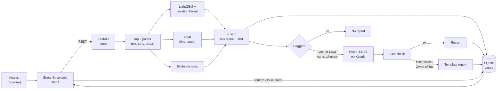

# SIMGuard AI

**SIM-swap fraud detection and investigation, with an explanation for every decision.**

A SIM swap is a common route to account takeover: a fraudster gets the victim's number moved to a SIM they control and then intercepts one-time passwords. SIMGuard AI looks at a swap event, scores how risky it is with three independent models, lists the evidence behind the score, and has a small language model write a short investigation report that a human analyst reviews and decides on.

> **Prototype on synthetic data.** Every number in this repository was measured on synthetic data. SIMGuard *recommends*; a human analyst makes the call. It is not ready for real subscriber data (see [Privacy and limits](#privacy-and-limits)).

| | |
|---|---|
| **Scoring engine** | LightGBM + Isolation Forest, with per-feature contributions |
| **Decision model** | A fine-tuned Laya (ModernBERT-large, 421M parameters): [`Kyoiske/simguard-laya-fraud`](https://huggingface.co/Kyoiske/simguard-laya-fraud) |
| **Reports** | Qwen 3.5 2B on a Kaggle GPU, fact-checked against the data before it is shown |
| **Input** | Free-text description in any wording, CSV, JSON, JSONL, TXT, or a guided form |
| **App** | FastAPI backend, SQLite case store, Streamlit analyst console |
| **Setup** | One command on Windows: `setup.bat` |

## Contents

1. [Quick start](#quick-start)
2. [How the system works](#how-the-system-works)
3. [Using the console](#using-the-console)
4. [Qwen 3.5 2B reports (Kaggle) and its login](#qwen-35-2b-reports-kaggle-and-its-login)
5. [Requirements](#requirements)
6. [Configuration](#configuration)
7. [Results](#results)
8. [Project layout](#project-layout)
9. [API](#api)
10. [Tests](#tests)
11. [Troubleshooting](#troubleshooting)
12. [Privacy and limits](#privacy-and-limits)

---

## Quick start

On Windows, with [Git](https://git-scm.com/download/win) installed:

```bat
git clone https://github.com/Rudraksh-wq/SIMGuard_AI.git
cd SIMGuard_AI
setup.bat
```

That is the whole setup. `setup.bat` does everything that is missing, then starts the app and opens **http://127.0.0.1:8501**:

| Step | What it does |
|---|---|
| 0 | Pulls the latest code from GitHub (only if you have no local edits; never merges) |
| 1 | Creates the Python environment (installs Python 3.12 automatically if the PC has none) |
| 2 | Installs PyTorch 2.15: the CUDA build when an NVIDIA GPU is present, otherwise the CPU build |
| 3 | Installs the pinned packages |
| 4 | Creates `.env`; asks once for the Qwen password (press Enter to skip) |
| 5 | Trains LightGBM + Isolation Forest if needed (about 10 seconds) |
| 6 | Downloads the fine-tuned Laya model from Hugging Face if missing or changed (about 850 MB) |
| 7 | Runs the tests after packages are (re)installed |
| start | Starts the API (port 8000) and the Streamlit console (port 8501) in the background |
| verify | Checks the API, scoring engine, database, Laya, free-text reading, the frontend, and renders every page |

The first run downloads about 3 GB (mostly PyTorch) and needs roughly 6 GB of free disk. Later runs take seconds.

| Command | Effect |
|---|---|
| `setup.bat` | Set up, start, verify, open the browser |
| `stop.bat` or `setup.bat --stop` | Stop the API and the frontend |
| `setup.bat --restart` | Stop, then start again |
| `setup.bat --status` | Show whether they are running |
| `setup.bat --no-browser`, `--no-pause` | Do not open the browser, never wait for a key (for scripts) |
| `setup.bat --no-start`, `--skip-tests`, `--no-update`, `--reinstall` | Set up only; skip tests; skip git and Hugging Face updates; rebuild the Python environment |

The servers run in the background with their output in `logs\`. Servers that are already running are reused, servers started before a code change are restarted automatically, and if port 8000 or 8501 is taken by another program the next free port is used. The exit code is 0 only when everything works. More detail is in [RUN.md](RUN.md).

> Reports from Qwen need the Kaggle notebook to be running. Without it everything else works and reports use a built-in template. See [Qwen 3.5 2B reports](#qwen-35-2b-reports-kaggle-and-its-login).

---

## How the system works



### The flow, step by step

1. **Input.** The analyst describes a swap event in their own words, uploads a file, or fills the guided form. The parser extracts the **11 model features** (below). If something cannot be found it says exactly what, and never guesses.
2. **Scoring engine.** LightGBM gives a fraud probability; an Isolation Forest, trained only on normal events, gives an anomaly score. Together they form the ML risk score: `100 × (0.7 × LightGBM + 0.3 × anomaly)`. The top feature contributions are kept to show *why*.
3. **Laya.** The event is turned into the exact text Laya was fine-tuned on, and Laya returns `p(fraud)`. Its gate says **block** (p ≥ 0.88), **allow** (p ≤ 0.12), or **human review** in between.
4. **Evidence rules.** Plain rules list the indicators (device, IMSI or ICCID changed, new SIM, repeated changes, IP change). This is the only source of the evidence list.
5. **Fusion.** The two scores are combined in log-odds (Laya weight 0.7) into one 0-100 risk score: low below 40, medium 40-69, high 70 and above. An event is **flagged** if Laya says fraud (p ≥ 0.5) *or* the ML risk score is 70 or more. The case also records whether the models **agree**.
6. **Report.** For flagged and human-review cases, Qwen 3.5 2B writes a short report from the verdict, scores, contributions and evidence. It explains the decision; it never makes one. The report is checked for invented numbers and over-claims; if it fails twice, or Qwen is offline, a template report is used.
7. **Human decision.** The analyst reviews the case and confirms fraud or marks a false alarm. Every step is stored in SQLite with an audit trail.

### The 11 features

| Feature | Meaning |
|---|---|
| `sim_swap_time_gap_minutes` | Time between the OTP request and the SIM change |
| `device_change_flag` | Device changed |
| `sim_type_change_flag` | SIM type changed (for example physical to eSIM) |
| `imsi_change_flag` | IMSI changed |
| `iccid_change_flag` | ICCID changed |
| `otp_and_sim_change_geo_hash_length` | Location similarity between the OTP request and the SIM change (0 = different place, 1 = same place) |
| `recent_sim_activation_days` | Days since the new SIM was activated |
| `num_sim_changes_last_30d` | SIM changes in the last 30 days |
| `previous_sim_holder_tenure_days` | How long the previous holder had the number |
| `account_age_days` | Account age |
| `ip_change_flag` | IP address changed |

### Why three models

- **LightGBM + Isolation Forest** is very precise on numbers but sees only the numbers. The Isolation Forest also catches patterns unlike normal traffic.
- **Laya** reads the event as text and was fine-tuned for this task. It is a fast second opinion and the human-review gate.
- **Qwen** is slow (12 to 40 seconds) and only runs where an explanation is needed, so the cheap models handle every event and the language model handles the few that matter.

---

## Using the console

Open **http://127.0.0.1:8501**. Pages: **Overview**, **Cases**, **Analyze**, **Data & metrics**, **System status**.

### Analyze: four ways in

| Tab | Use it for |
|---|---|
| **Describe in words** | Any wording: full sentences, notes, lists, number words ("forty five minutes"), units, percentages, `key: value` lines |
| **Guided questions** | A form with all 11 fields |
| **Upload file** | CSV, TSV, JSON, JSONL or TXT, up to 2,000 rows and 5 MB |
| **Paste CSV / JSON** | The same, pasted |

In **Describe in words**, if the text does not contain everything, the console shows how many values it understood, lists what is missing with an example for each, and lets you fill in only those. It never guesses a missing value.

Try these three:

**1. Looks like fraud**
```
SIM was swapped 6 minutes after an OTP request. New device, IMSI and ICCID both changed, and the SIM type changed to eSIM. Location similarity is 0.03. The SIM was activated 1 day ago, with 4 SIM changes in the last 30 days. The previous holder only had the number for 12 days. The account is 2 months old. IP address changed.
```
Expected: all 11 values read, flagged, Laya gate **block**, high score.

**2. Looks normal**
```
Customer replaced a damaged SIM in a store about three days after the OTP. Same device, IMSI unchanged, ICCID changed because of the new card, same SIM type, same IP. Location similarity 95%. SIM activated 400 days ago, no other SIM changes. The previous holder kept the number for 5 years and the account is 8 years old.
```
Expected: not flagged, Laya gate **allow**.

**3. Incomplete (tests the missing-values panel)**
```
SIM was changed 2 hours after the OTP. Device changed, IMSI unchanged. Location similarity 0.5. Two SIM changes in the last 30 days. The account is 3 years old.
```
Expected: "I understood 6 of the 11 values", and it asks for SIM type, ICCID, activation, previous-holder tenure and IP.

### A case

Each case shows the verdict and fused score, the LightGBM, Isolation Forest and Laya scores, the Laya gate, a chart of which features drove the score, the evidence, the report (with a live "Qwen is writing" state), the parsed input next to your original words, exactly what was sent to Qwen, and per-stage timing. The analyst then confirms fraud or marks a false alarm.

---

## Qwen 3.5 2B reports (Kaggle) and its login

Qwen runs in a public Kaggle notebook, [`rudraksh12/qwen3-5`](https://www.kaggle.com/code/rudraksh12/qwen3-5), on a free T4 GPU behind a password-protected link. It is started **by hand** when reports are needed, and **shuts itself down after 10 idle minutes** so it never burns GPU hours.

| | |
|---|---|
| **Username** | `simguard` (the default; the notebook also reads a `QWEN_USER` or `API_USER` secret) |
| **Password** | The `QWEN_PASSWORD` secret of the Kaggle notebook. **It is deliberately not written here:** this repository is public and git history is permanent, so a password in this file could be read by anyone. Ask the project owner, or use the one set in your Kaggle secrets. |
| **Link** | Changes every session; the app finds it automatically (see below) |

### Start it

1. Open the notebook and click **Edit**.
2. **Add-ons → Secrets**: make sure `QWEN_PASSWORD` is attached (add `QWEN_USER` or `API_USER` if you use a username other than `simguard`).
3. Check the session settings: **GPU T4**, **Internet on**.
4. **Save Version → Save & Run All**. After about 2 minutes the log shows `ENDPOINT: https://…gradio.live`, `IDLE SHUTDOWN: after 10 minutes…`.

Kaggle gives secrets only to runs started from the editor, not to runs started through its API, which is why there is no "start" button in the app.

### Tell the app the login

Any one of these:

- **Frontend (recommended):** **System status → Qwen 3.5 2B on Kaggle**: enter the username and password (and the link if you have it), tick *Remember in this browser*, and press *Save login & link*. They are stored in this browser's local storage, survive restarts, and override `.env`. The API keeps them in memory only. *Forget saved login & link* removes them.
- **`.env`:** set `QWEN_USER` and `QWEN_PASSWORD` (`setup.bat` asks for the password on the first run).
- **Environment:** set `QWEN_PASSWORD` before the first `setup.bat`.

### How the app finds the link

The notebook publishes its link to a public [ntfy](https://ntfy.sh) topic (only the link, never the password or any case data), on start and every 5 minutes, and publishes `offline` when it shuts down. The API reads that topic (`QWEN_DISCOVERY` in `.env`, set by default) and tries, in order: the last link that worked, a link pasted in the frontend, the discovered link, then `QWEN_ENDPOINT`. Dead links are skipped automatically. If you set the notebook's optional `NGROK_AUTHTOKEN` and `NGROK_DOMAIN` secrets, the link never changes.

### What Qwen is sent

For flagged and human-review cases (up to 3 per upload; the rest on demand), the API sends the verdict, the 11 features, the model scores and contributions, the evidence, non-label input context and, for typed text, the prompt. The dataset label is never sent. Every report is checked for numbers that are not in the data and for over-claims such as "confirmed fraud"; a failed check is retried once with a stricter instruction, then replaced by the template.

---

## Requirements

**Hardware**

| | Minimum | Recommended |
|---|---|---|
| GPU | None (CPU works, Laya about 0.5 s per event) | NVIDIA GPU with 4 GB or more VRAM (tested: RTX 3050 6 GB Laptop) |
| RAM | 8 GB | 16 GB |
| Disk | About 6 GB free | |

**Software**

- Windows 11 (tested). Linux and macOS are not set up by `setup.bat`.
- [Git](https://git-scm.com/download/win), to clone and to receive updates.
- Python 3.12 to 3.15: `setup.bat` finds one or installs 3.12 itself.
- A recent NVIDIA driver if you want GPU PyTorch; otherwise the CPU build is used and Laya still works.
- Internet on the first run (PyTorch, the Laya model) and for Qwen.
- A Kaggle account only if you run the Qwen notebook.

Versions are pinned in [`constraints.txt`](constraints.txt) (PyTorch 2.15, Laya 0.4.31, Transformers 5.22, LightGBM 4.7, FastAPI 0.162, Streamlit 1.67 and others).

---

## Configuration

`setup.bat` creates `.env` from [`.env.example`](.env.example). Everything has a default, so editing it is optional.

| Setting | Default | Meaning |
|---|---|---|
| `QWEN_USER` / `QWEN_PASSWORD` | `simguard` / empty | Login of the Kaggle notebook (the frontend can override it) |
| `QWEN_DISCOVERY` | `ntfy:simguard-…` | Where the notebook publishes its link |
| `QWEN_ENDPOINT` | empty | A fixed link (for example an ngrok domain) |
| `QWEN_MAX_AUTO_REPORTS` | 3 | Qwen reports written automatically per upload |
| `QWEN_TIMEOUT_S` | 90 | Seconds to wait for one report |
| `LAYA_FRAUD_THRESHOLD` | 0.5 | Laya `p(fraud)` at or above which a case is flagged |
| `LAYA_WEIGHT` | 0.7 | Laya's weight in the fused score |
| `LAYA_DEVICE` | `auto` | `auto`, `cuda` or `cpu` |
| `LAYA_MODEL` | the bundled checkpoint | Path of another Laya checkpoint |
| `DB_PATH` | `data/simguard.db` | The case database |
| `MOCK_MODELS` | 0 | `1` runs the API without LightGBM and Laya (for UI work) |

`.env` is git-ignored. Environment variables read by `setup.bat`: `SIMGUARD_PORT`, `SIMGUARD_UI_PORT`, `SIMGUARD_TORCH=cpu|cu132`, `SIMGUARD_VENV`.

---

## Results

All results are on **synthetic** data.

**LightGBM + Isolation Forest** (15,000 held-out rows, flagged at risk score ≥ 70)

| Precision | Recall | PR-AUC | Missed fraud | False alarms |
|---|---|---|---|---|
| 0.9991 | 0.9958 | 0.99993 | 47 | 10 |

Scoring takes about 3.7 ms per event, or 0.33 ms per event in a batch (the Isolation Forest is compiled to NumPy and gives exactly the same scores as scikit-learn).

**Fine-tuned Laya** (details in [`results_after_finetuining.md`](results_after_finetuining.md) and [`finetune/fraud_v2/runs/PERFORMANCE_REPORT.md`](finetune/fraud_v2/runs/PERFORMANCE_REPORT.md))

| | Base Laya | Fine-tuned |
|---|---|---|
| Test accuracy (6,000 rows) | 0.2565 | **0.9917** |
| Hard cases (600 deliberately difficult) | 0.5500 | **0.8333** |
| GPU latency (RTX 3050) | 41 ms | 39 ms (13 ms batched) |

The base model has no notion of SIM-swap fraud; fine-tuning took it from no signal to a working classifier. Its weak spot is events right at the decision boundary, which is why it is paired with the numeric models and a human-review gate.

**Free-text reading:** 12 differently worded descriptions (casual, shouting, bullet lists, number words, abbreviations), plus partial text, junk and false-positive guards, are covered by the tests.

**Qwen reports:** 12 to 40 seconds each on the Kaggle T4, written in the background so the console never waits.

---

## Project layout

```
SIMGuard_AI/
├── setup.bat, stop.bat          one-command setup, start, verify and stop (Windows)
├── api/                         FastAPI backend
│   ├── main.py                    endpoints
│   ├── pipeline.py                score → Laya → evidence → fuse → Qwen report
│   ├── fusion.py                  log-odds fusion and risk tiers
│   ├── input_parser.py            free text, CSV, JSON → the 11 features
│   └── db.py                      SQLite case store and audit log
├── agents/
│   ├── laya_agent.py              fine-tuned Laya, gate, GPU/CPU
│   ├── qwen_agent.py              Qwen client, link discovery, fact check
│   ├── evidence.py                rule-based indicators
│   ├── features_text.py           the 11 features and Laya's input text
│   └── schemas.py                 data contracts
├── ml/
│   ├── train.py                   trains LightGBM + Isolation Forest
│   └── score.py                   fast single and batch scoring
├── app/                         Streamlit analyst console (see app/README.md)
├── kaggle/                      the Qwen notebook (launch cell, build script)
├── finetune/                    Laya fine-tuning data, scripts and run reports
├── huggingface/README.md        model card of the published Laya model
├── tools/                       helpers used by setup.bat (servers, downloads)
├── tests/                       147 tests
├── sim_swap_fraud_dataset_100000.csv   synthetic dataset (73,907 fraud / 26,093 legitimate)
├── RUN.md, WORKLOG.md           run guide; a step-by-step log of what was built and measured
└── .env.example, constraints.txt
```

Generated and git-ignored: `.env`, `safe/` (Python environment), `data/` (case database), `logs/`, `ml/artifacts/` (trained models).

---

## API

Interactive docs at `http://127.0.0.1:8000/docs`. The main endpoints:

| Endpoint | Purpose |
|---|---|
| `POST /analyze` | Analyze one event (JSON with the 11 features) |
| `POST /analyze/input` | Analyze text, pasted JSON or CSV: `{content, kind}` |
| `POST /analyze/upload` | Analyze an uploaded CSV, TSV, JSON, JSONL or TXT file |
| `POST /parse` | Read input without analyzing: what was understood and what is missing |
| `GET /cases`, `GET /cases/{id}` | List and read cases |
| `POST /cases/{id}/report` | Write or rewrite the Qwen report |
| `POST /cases/{id}/review` | Record `confirmed` or `false_alarm` |
| `GET /health` | State of the scoring engine, database, Laya and Qwen |
| `GET /qwen/status`, `GET/POST/DELETE /settings/qwen` | Qwen link and login |

Example:

```bat
curl -X POST http://127.0.0.1:8000/analyze/input -H "Content-Type: application/json" ^
  -d "{\"kind\":\"text\",\"content\":\"SIM swapped 6 minutes after the OTP. New device, IMSI and ICCID changed, same SIM type, IP changed. Location similarity 0.03. SIM activated 1 day ago, 4 SIM changes in the last 30 days. Previous holder tenure 12 days, account age 60 days.\"}"
```

---

## Tests

```bat
safe\Scripts\python.exe -m pytest -q
```

147 tests cover the scoring engine, fusion, evidence, the parser (including the varied wordings), the Qwen client and its fact check, link discovery and failover, the server tooling, and the Streamlit pages (headless).

---

## Troubleshooting

| Problem | What to do |
|---|---|
| `setup.bat` says a server did not start | The last lines of `logs\api.log` / `logs\frontend.log` are printed; fix what they say and run it again |
| Port 8000 or 8501 is busy | Nothing: the next free port is used and the final message shows it |
| Qwen shows offline | Start the Kaggle notebook (see above). Until then reports use the template |
| Qwen login fails | Check the username and password in **System status** against the notebook's Kaggle secrets |
| Laya shows "CPU" on a PC with an NVIDIA GPU | Update the NVIDIA driver, then run `setup.bat` again. Laya still works on the CPU, about 10 times slower |
| Laya model download fails | Run `setup.bat` again; the app runs without Laya meanwhile |
| The code changed but the app looks old | `setup.bat --restart` |
| "you have local changes - not pulling" | You edited tracked files: commit or discard them to receive updates |

---

## Privacy and limits

- **Synthetic data only.** Do not enter real subscriber information. The guided form generates a synthetic subscriber token and file uploads must use `SYNTH-` tokens for identifier columns.
- **Decision support.** Scores and reports recommend; they do not establish that a person committed fraud. A human analyst must review every flag. A real "hold" needs telecom integration that this prototype does not have.
- **No authentication.** Keep the API and console on `127.0.0.1` and do not expose them to the internet.
- **Storage.** The API stores each case, including the original input, in SQLite. There is no automatic retention or deletion.
- **External services.** Qwen runs in a Kaggle notebook (what is sent is listed above); the link is found through the public ntfy.sh service (links only); the Laya model comes from Hugging Face on first setup; the console loads its fonts from Google Fonts.
- **Known weak spots.** Laya is about 83% accurate on deliberately hard boundary cases and is not perfectly batch-invariant for borderline scores. The free-text reader does not guess vague wording such as "different city" or "recently", and reports those values as missing.
- **Not DPDP-ready.** A subscriber hash can still be personal data. The prototype has no named operator, rights or grievance channel, or deletion workflow, so it is not presented as compliant with India's Digital Personal Data Protection Act, 2023. See [`app/README.md`](app/README.md) for details.

The Laya model is released under Apache-2.0, like the base model it was fine-tuned from; its model card is in [`huggingface/README.md`](huggingface/README.md).
